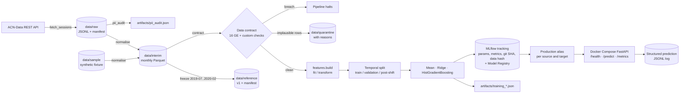
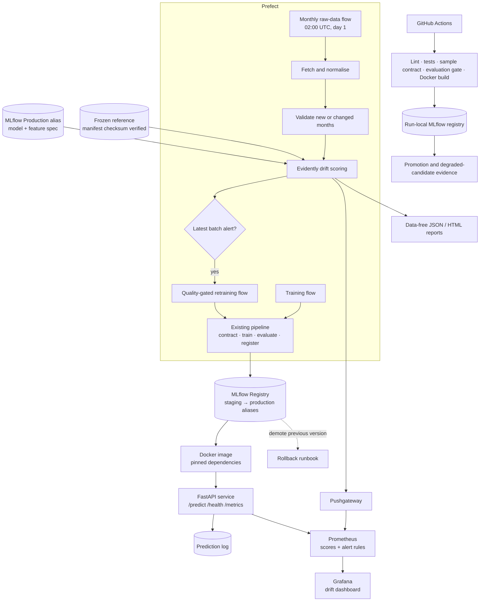

# Architecture

## V1 (Baseline) — implemented

Training entry point: `python -m evcharge.pipeline --source sample|raw`.
Container deployment: `docker compose up --build -d`. On an empty registry volume, the
bootstrap service trains the sample models before the API loads `evcharge-sample-energy`
from its `production` alias.

### Why the stages are ordered this way

The contract sits **between** normalisation and feature building, so a schema breach halts
the run before any model sees the data. `tests/test_pipeline.py` asserts training does not
execute when the contract fails — ordering is enforced, not merely intended.

### Two sources, one code path

`--source sample` reads the committed synthetic fixture; `--source raw` reads the licensed
extract. Everything downstream is identical, so the demo path exercises the real pipeline
rather than a reduced copy of it.

## V2 (Drift-aware monitoring implemented)

### What V1 already guarantees for V2

| V2 requirement | V1 foundation |
|---|---|
| Train/serve parity | `features.build` is the single definition; a fixed 1,000-session audit exercises request validation and normalization |
| Local prediction API | Compose loads the Production alias from MLflow; local development can still load a saved estimator and fitted feature spec |
| Promotion gate | Candidate promotion compares temporal validation MAE against both baselines and the Production model |
| Metrics and prediction evidence | `/metrics` exports counters and histograms; the API writes feature-only JSONL prediction records |
| Drift reference window | Versioned v1 snapshot with row counts and file/logical hashes; real rows stay out of public Git |
| Drift hypotheses | Predeclared and testable in `docs/drift_hypotheses.md` |
| Reproducible retraining | Partition replacement is rollback-safe; every run logs its input data hash |
| Detector ground truth | The March–April 2020 collapse is present, dated and measured |

### Drift detection design

A frozen reference window (2019-07 to 2020-02) is built by
`python -m evcharge.validation.reference --source raw` and compared against each
new or changed monthly batch on the model inputs, delivered-energy target, and
prediction distribution. The Evidently report and a data-free JSON summary are written
under `artifacts/drift/`; the snapshot records stay in the upGrad evaluation copy.

| Signal | Metric | Threshold |
|---|---|---|
| `kWhDelivered` distribution | PSI | > 0.2 raises an alert |
| Numeric inputs, target and prediction | KS statistic and p-value | p < 0.01 is reported |
| Inputs, target and prediction | Jensen-Shannon distance | Reported alongside PSI |
| Per-column evidence | Non-missing counts and missing fractions | Exported with each score |

The detector is then **validated rather than assumed**: it must fire on the known
March–April 2020 shift within one monthly batch. False alarms are measured out-of-sample;
the eight months forming the reference cannot be scored against that same reference and
counted as independent evidence. Sensitivity is measured using deterministic
multiplicative changes to delivered energy, not a synthetic-data package. Reproducible
detector and retraining results are in [`drift_evaluation.md`](drift_evaluation.md).

The monthly Prefect flow calls the retraining hook directly for an alert on the latest
available batch; Prometheus alert rules and Grafana provide a separate observability
surface and do not send a webhook back to Prefect. Score and retraining fingerprints are
persisted independently, so a failed export or retraining attempt is retried without
revalidating unchanged data or duplicating a successful retrain.

### Rollback

1. Identify the last known-good version in the MLflow Registry.
2. Repoint the model's `production` alias to that version.
3. Restart or redeploy the API so it reloads the Production alias.
4. Confirm `/health` and verify drift metrics return to reference levels.

The procedure is written down so recovery does not depend on the original author being
available — the failure mode called out in the Stage-Pitfalls guide.

## Known gaps

- **Post-shift recovery target remains unmet.** Chronological retraining experiments
  reduced the later held-out MAE relative to the original post-shift model in some
  windows, but the best tested MAE remains above the declared 10% recovery ceiling; see
  [`drift_evaluation.md`](drift_evaluation.md).
- **Rolling site occupancy** remains deliberately deferred. It requires a point-in-time
  join against session history; deriving it from the batch would make a prediction depend
  on which other rows happen to be scored alongside it. The deferral and feature rationale
  are documented in [`feature_specification.md`](feature_specification.md).
- **The fixture's generative process is log-linear**, so tree ensembles have less to exploit
  there than on real data. Fixture metrics verify the pipeline, not model quality.
