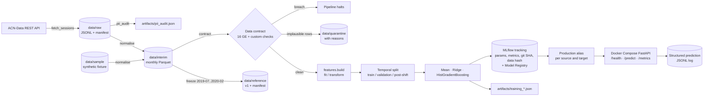

# Architecture

## V1 (Baseline) — implemented



Training entry point: `python -m evcharge.pipeline --source sample|raw`.
Container deployment: `docker compose up --build -d`. On an empty registry volume, the
bootstrap service trains the sample models before the API loads `evcharge-sample-energy`
from its `production` alias.

### Why the stages are ordered this way

The contract sits **between** normalisation and feature building, so a schema breach halts
the run before any model sees the data. `tests/test_pipeline.py` asserts training does not
execute when the contract fails — ordering is enforced, not merely intended.

### Two sources, one code path

`--source sample` reads the committed synthetic fixture; `--source raw` reads the licensed
extract. Everything downstream is identical, so the demo path exercises the real pipeline
rather than a reduced copy of it.

## V2 (Final target; registry and Compose serving implemented)

```mermaid
flowchart TB
  subgraph ORCH["Prefect orchestration"]
    A[Ingest] --> B[Validate<br/>Great Expectations]
    B --> C[Build features<br/>shared module]
    C --> D[Train]
    D --> E{Quality gate<br/>MAE regression?}
  end

  E -->|fail| F[Block promotion<br/>+ alert]
  E -->|pass|   G[(MLflow Registry<br/>staging → production aliases)]
  G --> H[Docker image<br/>pinned dependencies]
  H --> I[FastAPI service<br/>/predict /health /metrics]

  I --> J[(Prediction log)]
  J --> K[Evidently<br/>PSI · KS · JS divergence]
  L[(Frozen reference<br/>window)] --> K
  K --> M[Prometheus] --> N[Grafana<br/>dashboards + alert rules]
  N -->|threshold breach| O[Retraining trigger]
  O --> A

  P[GitHub Actions] --> R[Lint · tests · sample contract · evaluation gate · Docker build]
  R --> S[(Run-local MLflow registry)]
  S --> T[Promotion and degraded-candidate evidence]
  G -.->|demote previous version| Q[Rollback runbook]
```

### What V1 already guarantees for V2

| V2 requirement | V1 foundation |
|---|---|
| Train/serve parity | `features.build` is the single definition; a fixed 1,000-session audit exercises request validation and normalization |
| Local prediction API | Compose loads the Production alias from MLflow; local development can still load a saved estimator and fitted feature spec |
| Promotion gate | Candidate promotion compares temporal validation MAE against both baselines and the Production model |
| Metrics and prediction evidence | `/metrics` exports counters and histograms; the API writes feature-only JSONL prediction records |
| Drift reference window | Versioned v1 snapshot with row counts and file/logical hashes; real rows stay out of public Git |
| Drift hypotheses | Predeclared and testable in `docs/drift_hypotheses.md` |
| Reproducible retraining | Partition replacement is rollback-safe; every run logs its input data hash |
| Detector ground truth | The March–April 2020 collapse is present, dated and measured |

### Drift detection design

A frozen reference window (2019-07 to 2020-02) is built by
`python -m evcharge.validation.reference --source raw` and compared against each
incoming monthly batch on both input features and the prediction distribution. Its
data-free manifest is public; the snapshot records stay in the upGrad evaluation copy.

| Signal | Metric | Threshold |
|---|---|---|
| `kWhDelivered` distribution | PSI | > 0.2 raises an alert |
| Feature distributions | KS test | p < 0.01 |
| Prediction distribution | Jensen-Shannon | reported alongside PSI |

The detector is then **validated rather than assumed**: it must fire on the known
March–April 2020 shift within one monthly batch. False alarms are measured out-of-sample;
the eight months forming the reference cannot be scored against that same reference and
counted as independent evidence. Sensitivity is measured against batches carrying
controlled drift of known magnitude. See [`drift_hypotheses.md`](drift_hypotheses.md).

### Rollback

1. Identify the last known-good version in the MLflow Registry.
2. Repoint the model's `production` alias to that version.
3. Restart or redeploy the API so it reloads the Production alias.
4. Confirm `/health` and verify drift metrics return to reference levels.

The procedure is written down so recovery does not depend on the original author being
available — the failure mode called out in the Stage-Pitfalls guide.

## Known gaps

- **Rolling site occupancy** remains deliberately deferred. It requires a point-in-time
  join against session history; deriving it from the batch would make a prediction depend
  on which other rows happen to be scored alongside it. The deferral and feature rationale
  are documented in [`feature_specification.md`](feature_specification.md).
- **The fixture's generative process is log-linear**, so tree ensembles have less to exploit
  there than on real data. Fixture metrics verify the pipeline, not model quality.
